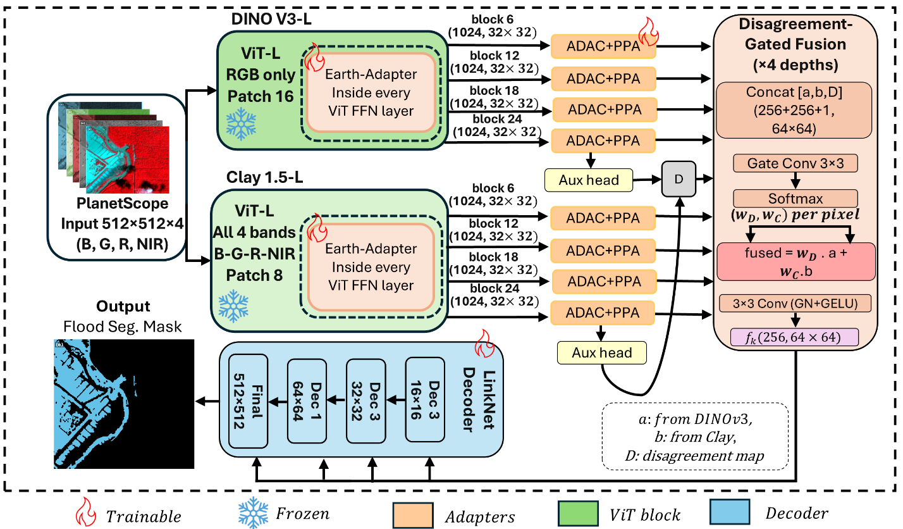

# FloodDuo

**A Dual Foundation-Encoder Architecture for Generalizable High-Resolution Flood Mapping**

Saurabh Kaushik, Beth Tellman, Qihao Weng — *ISPRS Journal of Photogrammetry and Remote Sensing*, 2026

[Paper](#citation) · [Results](results.md) · [Architecture](model.md) · [Figures](figures/) · [Run it on your own imagery ↓](#inference-run-it-on-your-own-imagery)

---

FloodDuo maps open water in high-resolution (3 m, 4-band B/G/R/NIR PlanetScope)
imagery by pairing two **frozen** vision foundation-model encoders that carry
complementary information:

- **DINOv3-L** (RGB) — sharp spatial / boundary detail.
- **Clay v1.5** (all four bands) — wavelength-conditioned spectral discrimination.

Convolutional networks preserve fine boundary detail but generalize poorly
to unseen regions; geospatial foundation models supply global context but, at
standard patch sizes, lose the detail that distinguishes a flooded street
from a dry one. FloodDuo keeps both: the frozen encoders are adapted with
lightweight trainable modules (an in-block frequency-domain Earth-Adapter,
plus post-hoc atrous-convolution and pyramid-pooling adapters), and their
branch predictions are merged by a **disagreement-gated fusion** whose
per-pixel Jensen-Shannon divergence doubles as a label-free reliability map,
before a LinkNet decoder produces the full-resolution mask. Only ~65M
parameters are trained against ~614M frozen.



## Inference: run it on your own imagery

This repo isn't only for reproducing the benchmark — the trained model is
released too. `notebook/inference_demo.ipynb` downloads the release
checkpoint and a sample tile from [Hugging Face](https://huggingface.co/Sk-21/FloodDuo)
and produces a flood map, no setup beyond installing packages:

```bash
pip install -r requirements.txt
jupyter notebook notebook/inference_demo.ipynb   # Run All
```

or directly in Python:

```python
from huggingface_hub import hf_hub_download
from src.inference import load_model, predict_file

ckpt = hf_hub_download("Sk-21/FloodDuo", "floodduo_full.pt")  # ~1.3 GB, one-time
model = load_model(ckpt)
prob, mask, profile = predict_file(model, "your_tile.tif")  # 4-band B,G,R,NIR
```

`predict_file` auto-detects and converts scaled integer DN (e.g. Planet's
Surface Reflectance product or Sentinel-2 L2A, both uint16 x10000) to
reflectance automatically — see `src/inference.to_reflectance` and the
notebook's Section 4 if your imagery uses a different scale factor.

The released checkpoint is self-contained (frozen DINOv3-L + Clay v1.5
backbones and FloodDuo's trained weights all in one file) and is the
**release model** — trained on all FloodPlanet + UFO data pooled, not one of
the paper's leave-one-region-out fold models. See the
[model card](https://huggingface.co/Sk-21/FloodDuo) for why its validation
score isn't the number to compare against the paper's headline result. Runs
on CPU (slower) or GPU; input is raw 4-band surface reflectance at the tile
size the model was evaluated at (512-1024 px) — no manual normalization and
no retraining needed.

### Fine-tuning on your own region

Have a handful of labeled tiles for a region, or flood type the
release model hasn't seen? `notebook/finetune_demo.ipynb` fine-tunes just
FloodDuo's adapters/fusion/decoder (~65M params; both frozen backbones stay
untouched) on a `finetune/` folder of a dozen-or-so labeled tiles, then
evaluates before vs. after on a *separate* `test/` folder of tiles from the
same region (not the ones fine-tuned on) — checking the adaptation
generalizes across the site, not just the specific tiles it saw — a few
minutes on a GPU. It ships with a small FloodPlanet example pair of folders
to demonstrate the workflow end to end; since that example region is already
in the release model's training data the before/after gap shown there is
modest — point it at your own two folders for a real improvement.

```bash
jupyter notebook notebook/finetune_demo.ipynb   # Run All
```

## Results

Evaluated under **leave-one-region-out (LORO)** cross-validation — every
model is trained with one of 19 FloodPlanet regions or 14 UFO flood-event
sites held out and never seen during training, which exposes the
cross-region generalization gap that a conventional random split hides
(random split overstates region-mean IoU by 5-7 pp on this same model; see
[results.md](results.md)).

| Model | FloodPlanet IoU | UFO IoU |
|---|---|---|
| **FloodDuo (ours)** | **0.728** | **0.819** |
| TerraMind-L | 0.700 | 0.789 |
| Prithvi-EO-2 | 0.678 | 0.774 |
| DOFA-L | 0.687 | 0.766 |
| Clay v1.5-L | 0.675 | 0.773 |
| CROMA-L | 0.672 | 0.715 |
| SSL4EO-S12 DINO | 0.650 | 0.767 |
| U-Net (from scratch) | 0.648 | 0.782 |

FloodDuo significantly outperforms U-Net (+8.0 / +3.7 pp) and the strongest
single-encoder foundation model (+2.8 / +3.0 pp, paired Wilcoxon on both).
Full tables — matched single-encoder controls, the disagreement-gated fusion
ablation, boundary-resolved error analysis, and the D-reliability.

## Installation

```bash
git clone https://github.com/Sk-2103/FloodDuo.git && cd FloodDuo
conda create -n floodduo python=3.11 -y && conda activate floodduo
pip install -r requirements.txt
```

## Data

FloodDuo is trained and evaluated on two public PlanetScope benchmarks
(3 m GSD, 4-band B/G/R/NIR, 1024×1024 tiles, `{split}/image/*.tif` +
`{split}/mask/*.tif`):

| Dataset | Regions | Download |
|---|---|---|
| FloodPlanet | 19 countries/US states | [Zenodo](https://zenodo.org/records/19698577) |
| Urban Flood Observations (UFO) | 14 flood-event sites | [Zenodo](https://zenodo.org/records/15238572) |

Download both and place them (or symlink them) so the layout matches:

```
data/
  floodplanet_planetScope/{train,val,test}/{image,mask}/*.tif
  UFO/{train,val,test}/{image,mask}/*.tif
```

Set `FLOODDUO_DATA` if you keep them elsewhere (see `src/paths.py`).

## Pretrained encoder weights

| Encoder | Source | Used for |
|---|---|---|
| DINOv3-L | auto-downloads via `timm` (`vit_large_patch16_dinov3.lvd1689m`) | FloodDuo's spatial branch |
| Clay v1.5 | [clay-foundation/model](https://github.com/Clay-foundation/model) → `clay-v1.5.ckpt` | FloodDuo's spectral branch |
| DOFA | [DOFA checkpoints](https://github.com/zhu-xlab/DOFA) | `spectral: dofa` baseline |
| Prithvi-EO-2, TerraMind, CROMA, SSL4EO-S12 DINO | via a vendored [pangaea-bench](https://github.com/VMarsocci/pangaea-bench) checkout | comparative LORO baselines |

Place the Clay/DOFA checkpoints under `pretrained/` and a pangaea-bench
checkout under `third_party/pangaea-bench/` (with its own
`pretrained_models/` populated per its instructions), or point
`FLOODDUO_CLAY_CKPT` / `FLOODDUO_DOFA_*_CKPT` / `FLOODDUO_PANGAEA_ROOT` at
wherever you keep them. None of this is required to just read or extend the
model code — only to run training/inference.

## Training

```bash
# Champion model, FloodPlanet
python -m src.train --config configs/arch6_fp.yaml

# One leave-one-region-out fold
python -m src.loro_fold --dataset floodplanet --region Ghana \
    --epochs 80 --lr 5e-4 --model-config configs/arch6_fp.yaml --seed 42

# The full LORO sweep behind the headline table (19 FP + 14 UFO folds)
bash scripts/run_loro_arch6.sh && bash scripts/run_loro_arch6_ufo.sh

# A deployable model trained on all FloodPlanet + UFO data (not the LORO protocol)
python -m src.train_deploy --config configs/arch6_fp.yaml \
    --split configs/deploy_split.json --epochs 120 --lr 5e-4

# The random-split vs. LORO comparison in results.md
python -m src.random_split --dataset floodplanet --model-config configs/arch6_fp.yaml
```

All the other reported models (matched single-encoder controls, comparative
foundation-model baselines, U-Net) have their own `configs/*.yaml` and
`scripts/run_loro_*.sh` orchestrator — see [results.md](results.md) for which
script produces which row.

Runs write to `runs/` by default (`FLOODDUO_RUNS` to override); each fold's
`result.json` carries its IoU/F1/precision/recall.

## Evaluation and tables

```bash
python -m src.eval --run runs/arch6_fp --dataset floodplanet
python scripts/show_loro.py --budget 80       # prints every LORO table in results.md
```

## Reproducing figures

Each figure script reads from `runs/` and writes to `outputs/manuscript_figs/`
(`FLOODDUO_VIZ` to override).

**Quick check** — once you have a few trained runs (at minimum FloodDuo,
U-Net, DOFA and TerraMind), regenerate 3 representative figures (the
headline quantitative comparison, the accuracy/compute summary, and a real
inference-driven qualitative gallery) to confirm everything works end to end:

```bash
bash scripts/make_key_figures.sh
```

**Everything else** — the remaining 13 figures, each as its own call. A few
need a small analysis pass first to produce the JSON/NPZ they plot from:

```bash
python scripts/boundary_analysis.py            # -> boundary_stats.json
python scripts/disagreement_full_analysis.py   # -> disagreement_stats.json, disagreement_cells.npz
python scripts/failure_disagreement.py         # -> failure_disagreement.json, failure_Dmaps.npz
python scripts/representation_stats.py         # -> representation_stats.json
python scripts/representation_rerun.py         # -> representation_rerun.json

python scripts/fig_boundary.py                 # Figure 9
python scripts/fig_disagreement.py             # Figure 13
python scripts/fig_failure.py                  # Figure 16
python scripts/fig_representation.py           # Figure 11
python scripts/fig_pr_scatter.py               # Figure 5
python scripts/fig_geo_map.py                  # Figure 6
python scripts/fig_complementarity_render.py   # Figure 12
python scripts/fig_gate.py                     # Figure 14
python scripts/fig_make.py --dataset ufo --regions HTX MID --mode detail  # Figures 8, 10
```

See [figures/README.md](figures/README.md) for the full script-to-figure map.

## Repository layout

```
src/
  models/        encoders (DINOv3, Clay, DOFA, + comparative baselines),
                 Earth-Adapter, ADAC/PPAdapter, disagreement-gated fusion,
                 LinkNet decoder, U-Net baseline
  data/          dataset loaders
  train.py, train_deploy.py, loro_fold.py, random_split.py, eval.py
  losses.py, metrics.py, paths.py, inference.py
configs/         one YAML per reported model (champion, ablations, matched
                 single-encoder controls, comparative baselines, U-Net)
scripts/         LORO orchestration, results tables, figure generation
notebook/        inference_demo.ipynb — run the release model on your own imagery
                 finetune_demo.ipynb — adapt it to a new region from a few labeled tiles
figures/         architecture figure used above; the rest regenerate from scripts
model.md         architecture detail
results.md       every reported table
```

## Citation

```bibtex
@article{kaushik2026floodduo,
  title   = {FloodDuo: A Dual Foundation-Encoder Architecture for Generalizable High-Resolution Flood Mapping},
  author  = {Kaushik, Saurabh and Tellman, Beth and Weng, Qihao},
  journal = {ISPRS Journal of Photogrammetry and Remote Sensing},
  year    = {2026}
}
```

## License

MIT — see [LICENSE](LICENSE). The FloodPlanet and UFO benchmarks have their
own licenses; see their Zenodo records.
